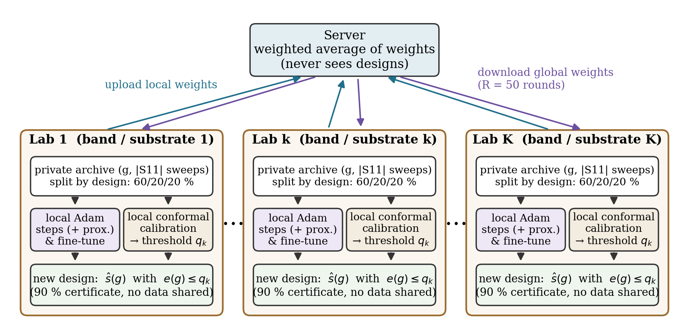
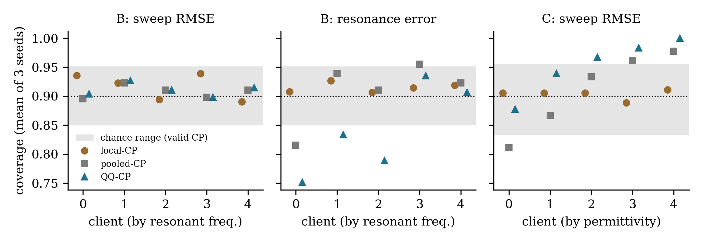

# Federated learning of antenna surrogates

Code and results for *Federated Learning of Antenna Surrogates Across Laboratories:
Physics-Informed Inputs, Personalization, and Per-Client Conformal Certificates*
(manuscript in preparation).


Several laboratories each own a private archive of patch-antenna simulations and will not
pool them. Can they still train one shared |S11| surrogate, and can each of them say how far
its predictions can be trusted? This repository trains the surrogate with federated learning,
where only model weights leave a lab. It then certifies every prediction with a design-level
conformal bound, and it reports coverage separately for every lab.



## Main findings

| | Result |
|---|---|
| Labs with similar archives | FedAvg closes 44 % (full-wave data) and 85 % (cavity model) of the gap between local and pooled training. |
| Labs on different bands / substrates | The global model underfits each lab's own range (R² 0.81 vs 0.975 local); a short local fine-tune restores 0.984 (pooled: 0.990). |
| More labs | With 10 band-shifted labs FedAvg falls below local training; fine-tuning stays ahead. |
| FedProx + Adam | The standard proximal loss stalls (R² 0.08); a decoupled proximal step trains normally (0.85). |
| Certificates | Under shift, thresholds shared across labs (pooled or one-round QQ) miss 90 % for some labs (down to 75 %, and 49 % for the centrally trained model); local calibration is valid for every lab and needs no communication. |

All numbers are means over three seeds; `results/summary.md` has every table.


*Coverage of each lab's 90 % certificate under band / substrate shift (mean of 3 seeds). Local
calibration (circles) stays inside the chance range for every lab; thresholds shared across labs
(squares, triangles) can drift out of it when the labs differ.*

## Setup

```bash
pip install -r requirements.txt
```

Python 3.13, CPU only (PyTorch 2.12). Dataset B (2051 full-wave rectangular patches,
[Hugging Face](https://huggingface.co/datasets/becklabash/rectangular-patch-antenna-freq-response))
is downloaded to `data/` on first use. Dataset C is generated in code from the cavity /
transmission-line patch model, so no download is needed.

## Reproduce

Regenerate every table and figure from the saved results (seconds):

```bash
cd code
python analyse.py            # results/summary.md + 3 figures
python figures_extra.py      # 6 further figures (uses results/preds/*.npz)
python analyse_ablation.py   # ablation table + FedProx figure
```

Re-run the experiments from scratch (several hours on a laptop CPU; runs are resumable):

```bash
cd code
python fl_antenna.py run --seed 0 --threads 2      # repeat for seeds 1 and 2
python ablate.py phys --ds B --seed 0               # physics-input ablation (B and C, 3 seeds)
python ablate.py prox --seed 0                      # coupled-FedProx ablation (3 seeds)
python tune_mu.py C 0.01                            # FedProx mu pilot on calibration designs
```

On Windows with Anaconda, set `KMP_DUPLICATE_LIB_OK=TRUE` if PyTorch reports a duplicate
OpenMP runtime (the scripts set it by default).

## Layout

```
code/
  fl_antenna.py        datasets, partitions, training (local / FedAvg / FedProx / fine-tune /
                       centralized), design-level conformal certificates, experiment driver
  analyse.py           tables (results/summary.md) and the main figures
  figures_extra.py     framework, data, example-prediction, per-client, K and trade-off figures
  ablate.py            physics-input and coupled-FedProx ablations
  analyse_ablation.py  ablation table and figure
  tune_mu.py           FedProx proximal-weight pilot
results/
  fl_clients_s*.csv    accuracy per client, method, configuration and seed
  fl_certs_s*.csv      certificate coverage and threshold per client, rule and score
  fl_curves_s*.csv     global-model R² every 5 rounds
  ablation_*.csv       ablation runs
  preds/*.npz          per-design predictions on every client's calibration and test designs
figures/               all figures in the manuscript
```

## Protocol details

- Clients hold disjoint sets of **designs**, and each client splits its own designs 60/20/20 %
  into train / calibration / test. No antenna appears in two sets.
- *IID*: designs dealt at random. *Shift*: designs sorted by resonant frequency (B) or substrate
  permittivity (C) and cut into contiguous blocks.
- Every method gets the same number of gradient steps per client (50 rounds × 200 steps).
- Conformal scores are computed per design: sup-norm sweep error, sweep RMSE and
  resonant-frequency error, with target coverage 90 %.

## Citation

Use the **Cite this repository** button on GitHub (from `CITATION.cff`). The journal reference
will be added on publication.

## License

Code: [MIT](LICENSE). Dataset B is not redistributed here. It is downloaded from its
Hugging Face page and remains under the terms set by its authors.
